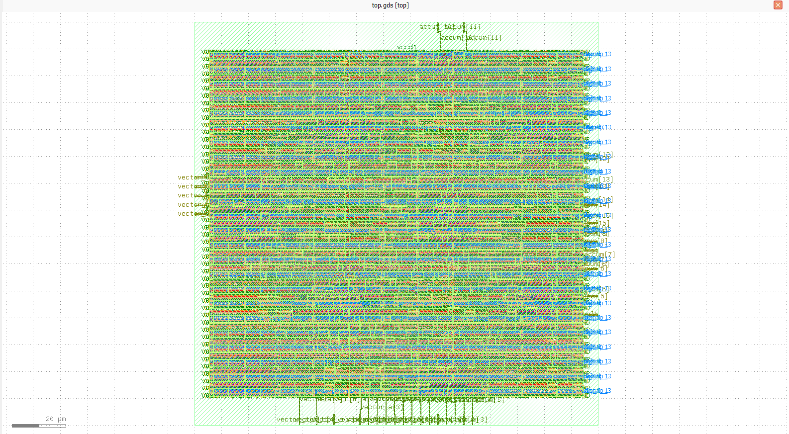

# Vector MAC Accelerator

Acelerador de inferencia de redes neuronales cuantizadas (int8 / int4), diseñado con
herramientas abiertas para SkyWater 130 nm. Hecho en Paraguay.

| Versión | Qué es | Estado |
|---|---|---|
| **Core-01** (`core01/`) | MAC escalar sin signo 8×8 → 16 bits | Primer layout físico, DRC limpio |
| **Core-02** (`rtl/`) | Acelerador GEMV int8/int4 con memorias, bus Wishbone y re-cuantización | RTL verificado en simulación; pendiente de pasar por OpenLane |

## Arquitectura de Core-02

```
              Wishbone 32 bits
                    │
        ┌───────────┴──────────────────────────────────────────┐
        │  CSR (ROWS, KWORDS, SHIFT, FLAGS, W_BASE, CYCLES...) │
        │                                                      │
        │  Memoria W ──┐                                       │
        │  (pesos)     ├──► DotUnit 4 carriles ──► Y   (int8)  │
        │  Memoria X ──┘    int8: 4 MAC/ciclo  └─► YACC (int32)│
        │  (entrada)        int4: 8 MAC/ciclo                  │
        │  Memoria bias ───► bias + shift + ReLU + saturación  │
        │                                                      │
        │  FSM: recorre las filas, X se reutiliza en cada fila │
        └──────────────────────────────────────────────────────┘
```

Una ejecución calcula una capa densa completa:
`y[r] = sat_int8( ReLU( (Σ_k W[r,k]·x[k] + bias[r]) >> SHIFT ) )`.
Varias capas pueden quedar cargadas a la vez en la memoria de pesos (`W_BASE`).

### Bloques

- **`rtl/dot_unit.py` — DotUnit.** 4 carriles en paralelo + árbol de sumas, operandos
  con signo, acumulador de 32 bits, pipeline de 3 etapas, modo int4 (2 MAC por carril),
  y re-cuantización con redondeo, ReLU y saturación a int8.
- **`rtl/accel_top.py` — AccelTop.** Esclavo Wishbone, CSR, memorias en chip, FSM GEMV y
  contador de ciclos. Mapa de registros documentado en el archivo y en `sw/accel_regs.h`.
- **`rtl/systolic.py` — SystolicArray.** Arreglo sistólico 4×4 *output-stationary* para
  multiplicación de matrices (16 MAC/ciclo, cada operando se reutiliza 4 veces).
  Verificado de forma independiente; todavía no está integrado en AccelTop.

### Software

- `sw/refmodel.py` — modelo de referencia bit-exacto en NumPy.
- `sw/driver.py` — driver en Python (carga de pesos, ejecución, lectura de resultados).
- `sw/accel_regs.h` — mapa de registros para firmware en C.

## Resultados

Demo `demo/digits_demo.py`: red 64 → 32 (ReLU) → 10 para dígitos manuscritos 8×8
(dataset *digits* de scikit-learn), cuantizada a int8 y ejecutada en el acelerador
simulado a través del bus:

| | Exactitud (540 imágenes de prueba) |
|---|---|
| Float32 | 95,9 % |
| int8 en el acelerador | 95,9 % — idéntico bit a bit al modelo de referencia |

~718 ciclos de cómputo por inferencia (2.368 MAC, 3,3 MAC/ciclo de 4 posibles):
≈14 µs a 50 MHz, sin contar la carga de datos por el bus.

Síntesis genérica con Yosys (`python build.py`, sin mapeo a Sky130; sirve para comparar):

| Bloque | Celdas genéricas | Flip-flops |
|---|---|---|
| Core-01 | 443 | 16 |
| DotUnit | 4.541 | 132 |
| SystolicArray 4×4 | 16.735 | 806 |
| AccelTop (preset tapeout) | 17.387 | 6.179 |

En AccelTop el 93 % de los flip-flops son las memorias. Para un tapeout real
conviene reemplazarlas por macros SRAM (DFFRAM u OpenRAM para Sky130).

## Uso

```bash
pip install -r requirements.txt
python -m pytest -v              # tests de todos los bloques vs NumPy
python demo/digits_demo.py       # red neuronal en el acelerador simulado
python build.py                  # Verilog en build/ + reporte de síntesis
```

Flujo físico (requiere OpenLane 2 y el PDK de Sky130):

```bash
python build.py --no-synth
openlane openlane/dot_unit/config.json     # bloque chico, buen siguiente tapeout
openlane openlane/accel_top/config.json    # acelerador completo
```

## Estructura

```
core01/     diseño original (Amaranth, Verilog, Yosys, OpenLane, layout)
rtl/        Core-02: DotUnit, SystolicArray, AccelTop
sw/         modelo de referencia, driver Python, header C
tests/      tests con el simulador de Amaranth
demo/       red neuronal de punta a punta
openlane/   configuraciones de diseño físico
build.py    generación de Verilog y síntesis
```

## Próximos pasos

1. Pasar `dot_unit` y `accel_top` por OpenLane y medir área y frecuencia reales.
2. Reemplazar las memorias de flip-flops por macros SRAM.
3. Integrar el arreglo sistólico en AccelTop como motor GEMM (capas convolucionales y lotes).
4. Encadenar capas en hardware (Y → X) para evitar el ida y vuelta por el bus.
5. Solapar filas en la FSM para acercarse a 4 MAC/ciclo.

## Core-01: vista física (GDSII en KLayout)


